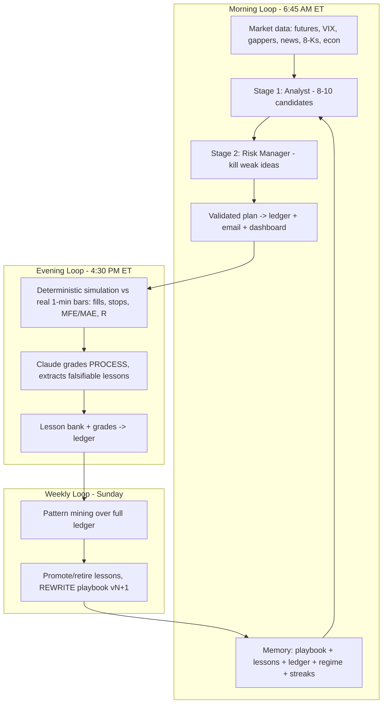

# Trade Agent

An AI trading analyst with **memory, feedback, and self-correction**. Not a chatbot that opines about stocks — a system where an LLM's picks are logged, graded against real intraday data every evening, and mined weekly into an evolving playbook. The learning loop is the product; without it, it's the same genius every day with amnesia.

> Paper-trading research tool. Nothing here is investment advice. It never places orders — Alpaca is used for market data only.

## Architecture



**The four memory layers** fed into every morning call:

1. **Trade Ledger** ([data/ledger.duckdb](data)) — append-only ground truth: every pick, fill, MFE/MAE, R-multiple.
2. **Lesson Bank** — evening-extracted insights with confirm/contradict counts.
3. **Evolved Playbook** ([playbook.md](playbook.md)) — the agent's accumulated skill, rewritten weekly, version-archived in [playbook_history](playbook_history). Git-track it to watch skill evolve.
4. **Regime State** — daily quantified market read (trend/risk/vol/breadth); the miner learns which setups work in which regime.

Plus a computed **self-awareness block**: streaks, hot/cold setups, and sizing rules the risk manager applies mechanically.

## Setup

```powershell
cd "c:\Users\Quantum Lab\Desktop\Trade Agent"
python -m venv .venv
.venv\Scripts\python -m pip install -r requirements.txt
.venv\Scripts\python run.py init
```

Then put your Anthropic API key in `credentials.json` (`anthropic_api_key`). Alpaca keys were carried over from Trader Light (market data only). Email is optional — fill the `smtp` block and set `"email_enabled": true` in [config.json](config.json).

## Daily operation

```powershell
.venv\Scripts\python run.py morning     # 6:45 AM ET — today's plan
.venv\Scripts\python run.py evening     # 4:30 PM ET — grade + extract lessons
.venv\Scripts\python run.py weekly      # Sunday — mine ledger, rewrite playbook
.venv\Scripts\python run.py status      # track record snapshot
.venv\Scripts\python run.py dashboard   # regenerate reports/dashboard.html
.venv\Scripts\python run.py regrade --from YYYY-MM-DD [--force]
                                         # recompute outcomes under current sim
                                         # semantics (explicit, opt-in only)
```

Automate with Windows Task Scheduler: run `scripts\setup_tasks.ps1` from an elevated PowerShell (times are local — adjust if not in ET).

### Testing without spending a cent

```powershell
# full pipeline, canned LLM responses + synthetic market data:
.venv\Scripts\python run.py morning --mock --offline --force
.venv\Scripts\python run.py evening --mock --offline --force
.venv\Scripts\python run.py weekly --mock
# build the real morning prompt (real data) but skip the API call:
.venv\Scripts\python run.py morning --dry-run
```

`--mock` is designed for a fresh DB (delete `data/ledger.duckdb` to reset). There's also a VS Code task: **Terminal > Run Task > Smoke Test**.

## How grading works (deterministic, conservative)

The evening loop replays each pick against real 1-minute bars:

- `open` entries fill at the 9:30 print; `limit`/`breakout` fill when touched (gap-throughs fill at the open price).
- If stop and target are touched in the same bar, **the stop wins** (conservative).
- Untriggered picks record `missed_move_r` — chronic near-misses are a process bug the grader sees.
- MFE/MAE in R quantify whether stops sit inside noise. Untouched picks exit at the close (`eod`).

## Costs

Morning (Opus, thinking + web search) + evening (Sonnet) + weekly (Opus) ≈ a few dollars/week at current pricing. Every run's tokens and estimated cost are logged to the `runs` table and shown in `status` and the dashboard.

## Project layout

| Path | Purpose |
|---|---|
| [run.py](run.py) | CLI entry point |
| [agent/config.py](agent/config.py) | layered config + paths |
| [agent/ledger.py](agent/ledger.py) | DuckDB schema + all queries |
| [agent/memory.py](agent/memory.py) | morning/weekly context assembly, playbook versioning |
| [agent/providers.py](agent/providers.py) | Alpaca + yfinance + EDGAR + econ calendar, offline fixtures |
| [agent/regime.py](agent/regime.py) | market regime engine |
| [agent/llm.py](agent/llm.py) | Claude wrapper: thinking, web search, JSON repair, cost accounting |
| [agent/grading.py](agent/grading.py) | trade simulation engine |
| [agent/delivery.py](agent/delivery.py) | email + HTML dashboard |
| [agent/loops/](agent/loops) | morning / evening / weekly orchestration |
| [prompts/](prompts) | the four system prompts, versioned |
| [playbook.md](playbook.md) | the agent's evolved rules (v1 = unvalidated priors) |
| [mocks/](mocks) | canned LLM + data fixtures for free pipeline tests |
| [data/econ_overrides.json](data/econ_overrides.json) | user-added econ events (CPI etc.) |

## The honest note

Day-to-day, the model narrates confidently whether or not it has edge. The ledger is what separates "sounds like a genius" from "is measurably improving." Give it 4–6 weeks of paper history before trusting any pattern the weekly miner claims — it labels anything under n=8 as provisional for exactly this reason.
