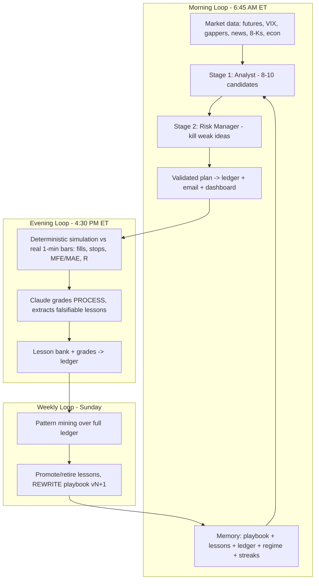

# Trade Agent

An AI trading analyst with **memory, feedback, and self-correction**. Not a chatbot that opines about stocks — a system where an LLM's picks are logged, graded against real intraday data every evening, and mined weekly into an evolving playbook. The learning loop is the product; without it, it's the same genius every day with amnesia.

> Paper-trading research tool. Nothing here is investment advice. Live execution is disabled by default and, when deliberately enabled, is restricted to Alpaca's paper host.

## Architecture



**The four memory layers** fed into every morning call:

1. **Trade Ledger** ([data/ledger.duckdb](data)) — append-only ground truth: every pick, fill, MFE/MAE, R-multiple.
2. **Lesson Bank** — evening-extracted insights with confirm/contradict counts.
3. **Evolved Playbook** ([playbook.md](playbook.md)) — the agent's accumulated skill, rewritten weekly, version-archived in [playbook_history](playbook_history). Git-track it to watch skill evolve.
4. **Regime State** — daily quantified market read (trend/risk/vol/breadth); the miner learns which setups work in which regime.

Plus a computed **self-awareness block**: streaks, hot/cold setups, and sizing rules the risk manager applies mechanically.

## Setup

```powershell
cd "c:\Users\Quantum Lab\Desktop\Trade Agent"
python -m venv .venv
.venv\Scripts\python -m pip install -r requirements.txt
.venv\Scripts\python run.py init
```

Then put your Anthropic API key in `credentials.json` (`anthropic_api_key`). Alpaca keys were carried over from Trader Light (market data only). Email is optional — fill the `smtp` block and set `"email_enabled": true` in [config.json](config.json).

### Optional live paper execution

Live paper orders are an observation stream alongside the deterministic simulator. They are disabled by default. To enable them only after the verification checklist is complete, set `live_paper.enabled` and `live_paper.alpaca_paper` to `true` in [config.json](config.json), keep `trading_base` exactly `https://paper-api.alpaca.markets`, and provide paper-account credentials. Any other host or a missing explicit paper flag refuses placement. Breakout picks are recorded as simulator picks but are skipped for live placement until stop-entry plus OCO support is added.

**Intraday trigger (how paper trades are managed today).** A Windows scheduled task, `TradeAgent-Intraday`, runs `scripts\intraday_cron.ps1` on weekdays. From 09:35 to 15:59 ET it calls `POST /cron/intraday-check` on production every 5 minutes, aligned to the clock. Each call runs the live monitor, closes positions left open overnight (`carry_cleanup`), and runs a runner scan/selection tick, all server-side against the production ledger. The call authenticates with `INTRADAY_TRIGGER_SECRET`, a Vercel env var that authorizes that endpoint and nothing else. Its local copy lives in `%USERPROFILE%\.trade-agent\intraday_trigger_secret`, with a log beside it (`intraday.log`). The dashboard's Learning loop panel shows when the monitor last ran. If the machine is off, positions are not managed intraday: the next morning run or first tick closes anything left open. Vercel Pro (`*/5` crons) would remove the dependency on this machine.

The intraday monitor is not in `vercel.json` because Vercel Hobby crons run at most once per day, and the monitor needs a tick every few minutes. The route is `POST /cron/intraday-check`. On each tick it records fills, cancels any entry still unfilled at its `time_stop`, closes positions at their `time_stop` (cancelling the bracket legs that hold the shares first), and flattens every open position at 15:55 ET so nothing is held overnight. Without a trigger none of that happens: the dashboard's Learning loop panel warns when live orders go unreconciled. A GitHub Actions scheduler can call it every five minutes (the shipped workflow has been failing at startup since 2026-09-09 due to an account-level Actions block; `scripts\intraday_cron.ps1` is the local stand-in):

```yaml
on:
    schedule:
        - cron: "*/5 13-20 * * 1-5"
jobs:
    intraday-check:
        runs-on: ubuntu-latest
        steps:
            - run: |
                    curl --fail-with-body -X POST \
                        -H "Authorization: Bearer ${{ secrets.TRADE_AGENT_CRON_SECRET }}" \
                        "${{ secrets.TRADE_AGENT_URL }}/cron/intraday-check"
```

Set `CRON_SECRET` in the Vercel project environment and create matching GitHub repository secrets `TRADE_AGENT_CRON_SECRET` and `TRADE_AGENT_URL` (the deployed HTTPS origin, without a trailing slash). The endpoint rejects missing or mismatched bearer tokens and independently skips weekends, holidays, and outside-hours calls.

### Hosted schedule (vercel.json, UTC)

| Cron | Schedule | Fires (ET, summer / winter) | Job |
|---|---|---|---|
| `/cron/morning` | `45 10 * * 1-5` | ~7:11 / ~6:11 | premarket plan, analyst half (hands the risk half to `/cron/morning-continue`) |
| `/cron/morning-continue` | `15 12 * * 1-5` | 8:15–9:14 / 7:15–8:14 | safety net: finishes a morning whose risk half never ran |
| `/cron/runner` | `30 14 * * 1-5` | ~11:18 / ~10:18 | runner scan + selection |
| `/cron/runner-late` | `30 15 * * 1-5` | 11:30–12:29 / 10:30–11:29 | second runner tick; the only in-window tick in winter |
| `/cron/evening` | `30 20 * * 1-5` | ~17:xx / ~16:xx | grading, shadow ledger, lessons |
| `/cron/weekly` | `0 14 * * 6` | Saturday morning | weekly mining + playbook rewrite (filed under Friday's session) |

Hobby crons fire at the scheduled minute plus a fixed offset of up to ~59 minutes (the observed times are above). Each handler re-checks the ET hour and refuses to run outside its window. The weekly miner has its own invocation: it used to run chained after Friday's evening grading inside one 300-second function budget, where a timeout lost the week's playbook rewrite. The morning runs as two invocations for the same reason (specs/MORNING_BUDGET_SPEC_v1.md): the analyst half saves a checkpoint and starts the risk half by calling `/cron/morning-continue` on this deployment, and the `15 12` cron resumes any checkpoint that call never reached. Locally, `run.py morning` runs both halves in one process.

Breakout picks have a separate `live_paper.breakout_two_step` gate. It defaults to `false`, so breakout picks remain simulator-only even when ordinary live paper orders are enabled. When deliberately testing this path, the monitor submits a plain stop entry, arms an OCO exit only after the entry fills, cancels unfilled entries at the time/flatten cutoff, and force-closes immediately if OCO arming fails. Keep this flag off until the two-step manual dry run and failsafe test in the execution spec have been observed in the paper account.

## Daily operation

```powershell
.venv\Scripts\python run.py morning     # 6:45 AM ET — today's plan
.venv\Scripts\python run.py evening     # 4:30 PM ET — grade + extract lessons
.venv\Scripts\python run.py weekly      # weekend — mine ledger, rewrite playbook
.venv\Scripts\python run.py status      # track record snapshot
.venv\Scripts\python run.py dashboard   # regenerate reports/dashboard.html
.venv\Scripts\python run.py regrade --from YYYY-MM-DD [--force]
                                         # recompute outcomes under current sim
                                         # semantics (explicit, opt-in only)
```

Automate with Windows Task Scheduler: run `scripts\setup_tasks.ps1` from an elevated PowerShell (times are local — adjust if not in ET).

### Testing without spending a cent

```powershell
# full pipeline, canned LLM responses + synthetic market data:
.venv\Scripts\python run.py morning --mock --offline --force
.venv\Scripts\python run.py evening --mock --offline --force
.venv\Scripts\python run.py weekly --mock
# build the real morning prompt (real data) but skip the API call:
.venv\Scripts\python run.py morning --dry-run
```

`--mock` is designed for a fresh DB (delete `data/ledger.duckdb` to reset). There's also a VS Code task: **Terminal > Run Task > Smoke Test**.

## How grading works (deterministic, conservative)

The evening loop replays each pick against real 1-minute bars:

- `open` entries fill at the 9:30 print; `limit`/`breakout` fill when touched (gap-throughs fill at the open price).
- If stop and target are touched in the same bar, **the stop wins** (conservative).
- Untriggered picks record `missed_move_r` — chronic near-misses are a process bug the grader sees.
- MFE/MAE in R quantify whether stops sit inside noise. Untouched picks exit at the close (`eod`).

## Persona (earned hunger)

One character sheet, [prompts/persona.md](prompts/persona.md), is shared by the five system prompts (analyst, risk, grader, miner, selector), each of which also gets its own role section. The character is a competitive trader who treats "unproven" as a debt he owes the scoreboard: his aggression points at his own ignorance, never at the tape. Spec: [specs/PERSONA_CHARACTER_SHEET_SPEC_v1.md](specs/PERSONA_CHARACTER_SHEET_SPEC_v1.md).

- **Flag:** `"persona": {"enabled": true|false, "version": 1}` in `config.json` (default off). `version` pins the sheet that was switched on; a `persona.md` carrying another version is not used. Off, every rendered prompt is byte-identical to the pre-persona text (`tests/fixtures/prompt_renders/`).
- **Guardrails:** P-1 prose never becomes evidence (the sheet carries no digit, so it adds no number to any prompt or to the grader's grounding corpus); P-2 hunger is for evidence velocity, not trade count (no gate, lane, size or threshold changed); P-3 beliefs are not evidence (only `[rule: R...]` rules are acted on); P-4 it is a treatment; P-5 additive and reversible (one config line).
- **Treatment, measured:** plans, picks and runs it influenced carry `persona_version` (migration v29; NULL = off). `run.py persona-monitor [--sessions N]` prints counts and distributions per group (trade count, size, conviction, floor/coverage/probe rates, runner selection) and no test or verdict: on/off periods are different calendar periods under different tape.

## Trader's log

After the evening grading, the desk writes a short first-person log for its owner, appended to the evening email with a counts-only "winners and losers" table. Spec: [specs/TRADERS_LOG_SPEC_v1.md](specs/TRADERS_LOG_SPEC_v1.md).

- **Flag:** `"traders_log": {"enabled": true|false, ...}` in `config.json` (default off). One Sonnet call per session, about three cents.
- **Numbers by reference:** the model is given slots the system already computed and writes `{{slot}}` tokens; any digit (or number word past "two") in its own text is refused. One retry, then a labeled facts-only fallback. A failure never touches grading, the playbook or the email.
- **Write-only:** no loop, prompt, memory builder, miner, selector or grader reads it; `tests/test_traders_log_firewall.py` enforces that. Browse it at `/api/table/traders_log` or with `run.py traders-log --show [--date YYYY-MM-DD]`.

## Costs

Morning (Opus, thinking + web search) + evening (Sonnet) + weekly (Opus) ≈ a few dollars/week at current pricing. Every run's tokens and estimated cost are logged to the `runs` table and shown in `status` and the dashboard.

## Project layout

| Path | Purpose |
|---|---|
| [run.py](run.py) | CLI entry point |
| [agent/config.py](agent/config.py) | layered config + paths |
| [agent/ledger.py](agent/ledger.py) | DuckDB schema + all queries |
| [agent/memory.py](agent/memory.py) | morning/weekly context assembly, playbook versioning |
| [agent/providers.py](agent/providers.py) | Alpaca + yfinance + EDGAR + econ calendar, offline fixtures |
| [agent/regime.py](agent/regime.py) | market regime engine |
| [agent/llm.py](agent/llm.py) | Claude wrapper: thinking, web search, JSON repair, cost accounting |
| [agent/grading.py](agent/grading.py) | trade simulation engine |
| [agent/delivery.py](agent/delivery.py) | email + HTML dashboard |
| [agent/loops/](agent/loops) | morning / evening / weekly orchestration |
| [prompts/](prompts) | the system prompts, versioned, plus the shared persona sheet |
| [playbook.md](playbook.md) | the agent's evolved rules (v1 = unvalidated priors) |
| [mocks/](mocks) | canned LLM + data fixtures for free pipeline tests |
| [data/econ_overrides.json](data/econ_overrides.json) | user-added econ events (CPI etc.) |

## The honest note

Day-to-day, the model narrates confidently whether or not it has edge. The ledger is what separates "sounds like a genius" from "is measurably improving." Give it 4–6 weeks of paper history before trusting any pattern the weekly miner claims — it labels anything under n=8 as provisional for exactly this reason.
